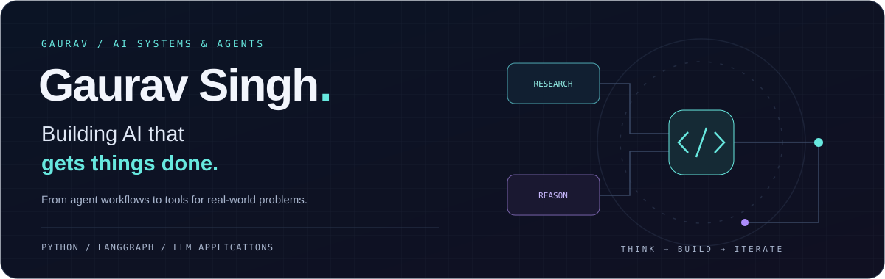
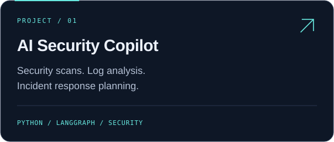
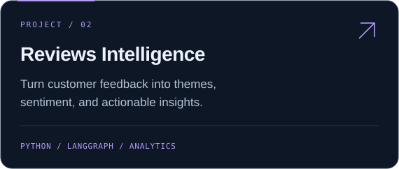
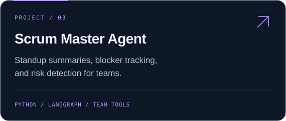
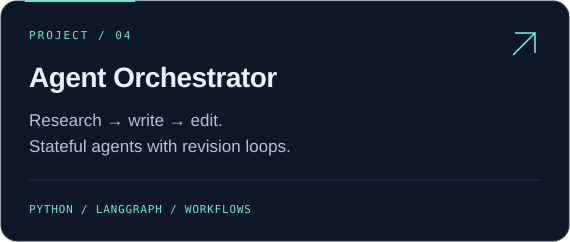

  

  <strong>AI agents · Developer tools · Practical automation</strong> 
  I build agent workflows that turn complex tasks into useful outcomes. 
  My projects explore security, customer insights, engineering workflows, and practical device cleanup.

  <a href="#selected-builds">Explore my projects</a> &nbsp;·&nbsp;
  <a href="https://github.com/gauravsinghbitmesra-design?tab=repositories">All repositories</a>

## Selected builds

### [Agent Footprint](https://github.com/gauravsinghbitmesra-design/agent-footprint)

**What are Claude Code and Codex leaving on your laptop?** A local, read-only CLI for supported disk usage, selected process statistics and private HTML reports. No API key or runtime dependencies. MIT licensed.

  

[Try it →](https://github.com/gauravsinghbitmesra-design/agent-footprint#try-it-in-a-minute) · [View synthetic demo](https://gauravsinghbitmesra-design.github.io/agent-footprint/)

### [Fire TV Cleanup](https://github.com/gauravsinghbitmesra-design/firetv-cleanup)

Reversible **Amazon Fire TV cleanup and optimization**, a clean **Projectivy** home screen, private backups, and recovery instructions. Includes shared prompts for **ChatGPT/Codex and Claude Code**, with an observed-device profile and clearly documented compatibility limits.

  

[Get started →](https://github.com/gauravsinghbitmesra-design/firetv-cleanup#quick-start) · [Restore guide](https://github.com/gauravsinghbitmesra-design/firetv-cleanup/blob/main/docs/restore.md) · [MIT license](https://github.com/gauravsinghbitmesra-design/firetv-cleanup/blob/main/LICENSE)

  
  

  
  

- **[AI Security & Incident Copilot](https://github.com/gauravsinghbitmesra-design/ai-security-incident-copilot)** — Scan repositories, analyze logs, and generate incident response plans.
- **[Reviews Intelligence Agent](https://github.com/gauravsinghbitmesra-design/reviews-intelligence-agent)** — Extract themes, sentiment, trends, and quality issues from customer reviews.
- **[Scrum Master Agent](https://github.com/gauravsinghbitmesra-design/scrum-master-agent)** — Capture daily updates, summarize standups, and surface delivery risks.
- **[LangGraph Agent Orchestrator](https://github.com/gauravsinghbitmesra-design/langgraph-agent-orchestrator)** — Coordinate researcher, writer, and editor agents with feedback loops.

## In my toolkit

`Python` `LangGraph` `Pydantic` `pytest` `OpenAI` `Anthropic` `Ollama`

I’m interested in stateful agent workflows, useful command-line tools, and making LLM applications easier to inspect and extend.

---

Think clearly. Build useful things. Keep iterating.

